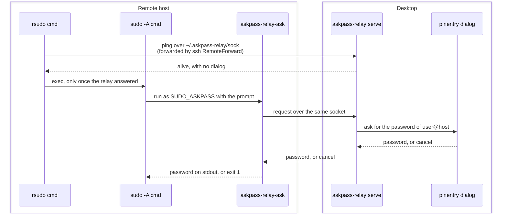

# askpass-relay

`askpass-relay` lets a non-interactive `ssh host 'rsudo ...'` ask for the sudo password in a
dialog on your desktop. sudo on the remote host runs `askpass-relay-ask` as its askpass program.
It sends the request over a unix socket that ssh forwards back to your desktop. There
`askpass-relay serve` shows a pinentry dialog that asks for the password of that account on that
host and names the command, and returns the password you type, or a cancel.



## Behaviour

- One dialog at a time. A request waits for the requests before it.
- A dialog that gets no answer in 60 seconds (`serve --timeout`) counts as a cancel.
- On a cancel, a timeout, a missing socket or a relay that is down, `ask` prints nothing and
  exits with status 1, so sudo fails at once.
- The dialog is `pinentry-gnome3` by default (`serve --pinentry <program>` picks another
  pinentry, for example `pinentry-qt`). When the pinentry cannot show a dialog at all, `zenity`
  asks instead (`--fallback <program>`, or `--no-fallback`).
- The password lives only in memory, in buffers that are wiped when dropped. It is never logged.
  The service log names the host, the user, the command and the outcome.
- Both sockets are owned by the user with mode 0600, inside a directory with mode 0700.

## Protocol

Each message is one frame: a big-endian `u32` payload length, then the payload. The payload is
the protocol version, a message kind, and fields, each a big-endian `u16` length and its bytes.
A request (version 2) carries the host, the user, sudo's prompt, the command line of the sudo
process and the caller's reason, empty when there is none. A ping (version 2, no fields) asks
the relay to answer without a dialog. The relay also reads version 1 requests, which have no
reason. The answer (version 1) is a password, a cancel, a failure with its reason, or the
answer to a ping. Frames over 64 KiB, another version, an unknown kind, a missing field or
trailing bytes are rejected.

## Install on the desktop

```sh
cargo install --path .
mkdir -p ~/.config/systemd/user
cp contrib/askpass-relay.service ~/.config/systemd/user/
systemctl --user daemon-reload
systemctl --user enable --now askpass-relay.service
systemctl --user status askpass-relay.service
```

The unit starts with the graphical session, so the dialog finds the Wayland or X11 display.
`journalctl --user -u askpass-relay` shows each request and its outcome.

## The ssh configuration

One dedicated ssh connection per host carries the socket. Add an alias per host to
`~/.ssh/config` on the desktop. The remote path is absolute, because sshd resolves no `~` in a
forwarded socket path. Replace `1000` with your uid (`id -u`).

```sshconfig
Host askpass-relay-pro
    HostName pro.example
    User remote-user
    RemoteForward /home/remote-user/.askpass-relay/sock /run/user/1000/askpass-relay/sock

Host askpass-relay-air
    HostName air.example
    User remote-user
    RemoteForward /Users/remote-user/.askpass-relay/sock /run/user/1000/askpass-relay/sock

Host askpass-relay-*
    ControlMaster no
    ControlPath none
    ExitOnForwardFailure yes
    ServerAliveInterval 15
    ServerAliveCountMax 3
```

A user unit keeps each connection up and restarts it when it drops:

```sh
cp contrib/askpass-relay-forward@.service ~/.config/systemd/user/
systemctl --user daemon-reload
systemctl --user enable --now askpass-relay-forward@pro askpass-relay-forward@air
```

The everyday `Host pro` and `Host air` entries carry no forward. A connection that requests the
forward binds the remote socket in place of the one before it, and when that connection closes
it leaves the file behind with nothing listening. Only the dedicated connection requests it, so
an agent's own connections, shared or not, never take the socket over.

sshd leaves the socket file behind when a connection closes. With `StreamLocalBindUnlink yes` in
the remote sshd (see below), a restarted forward replaces it. On a host without it, `ask` removes
a stale socket it finds, and the next start of the forward binds a live one.

## Install on a remote host

```sh
git archive HEAD | ssh host 'mkdir -p ~/src/askpass-relay && tar -x -C ~/src/askpass-relay'
ssh host 'cd ~/src/askpass-relay && cargo install --locked --path .'
ssh host 'mkdir -p -m 700 ~/.askpass-relay && cd ~/.cargo/bin \
  && ln -sf askpass-relay askpass-relay-ask && ln -sf askpass-relay rsudo'
```

sudo runs `SUDO_ASKPASS` as a bare path with the prompt as its only argument. Under the name
`askpass-relay-ask` the binary acts as `askpass-relay ask`, and under the name `rsudo` it acts as
`askpass-relay sudo`.

Export `SUDO_ASKPASS` in the file the remote login shell reads for non-interactive ssh commands.
For zsh that is `~/.zshenv` (with a custom `ZDOTDIR`, `$ZDOTDIR/.zshenv`); for bash it is
`~/.bashrc`, above its interactive-only guard.

```sh
export SUDO_ASKPASS="$HOME/.cargo/bin/askpass-relay-ask"
```

Then let the remote sshd replace stale sockets. This needs root once, through the relay itself:

```sh
ssh host 'printf "StreamLocalBindUnlink yes\n" | sudo -A tee /etc/ssh/sshd_config.d/10-askpass-relay.conf'
ssh host 'sudo -A sshd -t'                     # check the configuration
ssh host 'sudo -A systemctl reload sshd'       # Linux; macOS reads it on the next connection
```

## Use from an agent or a script

```sh
ssh pro 'rsudo --reason "install docker for the live stands" pacman -S --noconfirm docker'
ssh air 'askpass-relay sudo --reason "check the relay" -- true'
```

`rsudo` runs `sudo -A` with the command, after a check that the password can reach a dialog. When
sudo needs a password (`sudo -n true` fails), it pings the relay through the socket: the desktop
answers without a dialog. When the relay does not answer, `rsudo` exits with status 1 and the
fix, and sudo never runs. This matters because once sudo has started the askpass program, a
failure counts as a failed login against the host's lockout policy.

The desktop shows a dialog. Approve it, and the command runs. Cancel it, and sudo exits with an
error at once.

The dialog is titled "sudo password for <user>@<host>" and shows the command that asked. The
reason comes from `--reason` or from `ASKPASS_RELAY_REASON`; plain `sudo -A` reads the variable
too:

```sh
ssh pro 'ASKPASS_RELAY_REASON="install docker for the live stands" sudo -A pacman -S docker'
```

sudo starts the askpass program with the caller's environment, so the variable reaches `ask` on
Linux and on macOS. The dialog shows the reason on one line below the command; the title and the
command stay whatever the reason says.

A wrong password makes sudo ask again, up to three times, and each failure counts against the
host's lockout policy (`pam_faillock` on Arch locks the account for ten minutes after three).

`ask` has its own options for a manual check: `askpass-relay ask --socket <path> "<prompt>"`.
`ASKPASS_RELAY_SOCKET` overrides the default socket `~/.askpass-relay/sock`.

## Development

```sh
cargo test
cargo clippy --all-targets -- -D warnings
cargo fmt --check
```

The tests drive `serve` with a fake pinentry script and `ask` against it through a real socket:
approval, cancel, timeout, a missing socket, a stale socket and a malformed frame.
